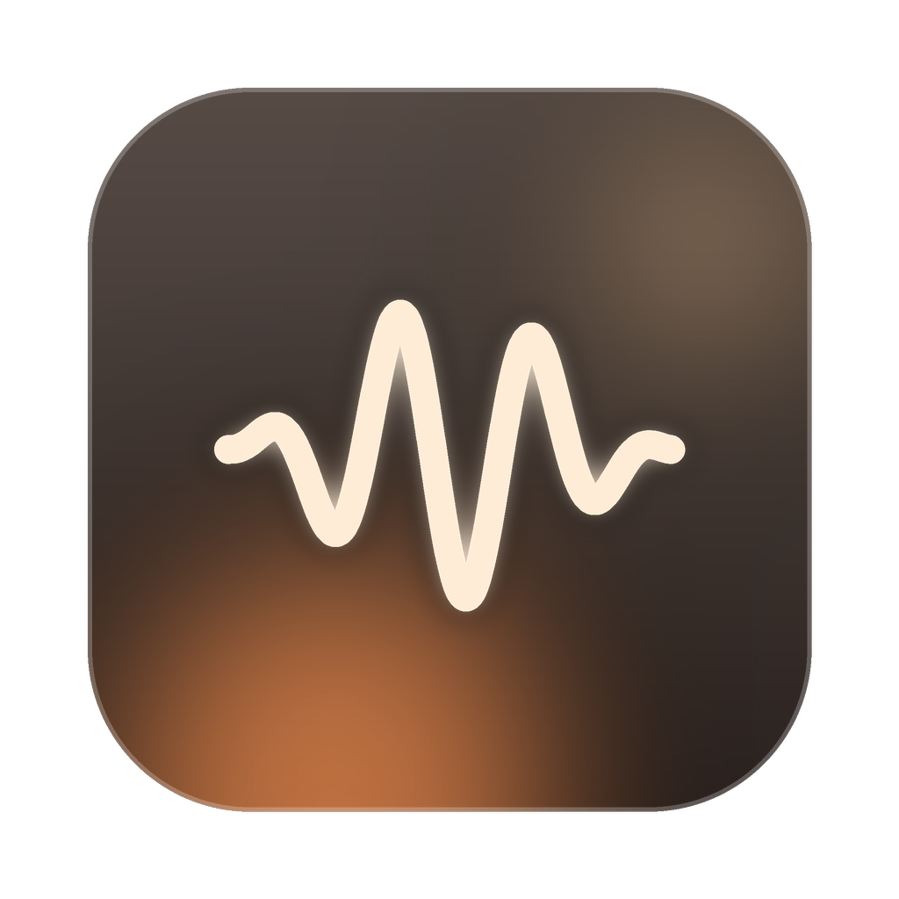

<p align="center"></p>

<h1 align="center">AI Pulse</h1>

<p align="center">Claude Code · Codex · Claude 앱의 작업 상태를 macOS 메뉴바에서 한눈에.<br>
See what your AI agents are doing — right from the macOS menu bar.</p>

---

## 기능

- **실시간 상태** — 분석 중 · 코드 작성 · 테스트 · 승인 대기 · 완료 · 오류
- **진행률과 단계** — 에이전트의 작업 체크리스트가 있으면 단계별 진행과 소요 시간, 없으면 지금 하는 일
- **승인 요청 우선** — 승인이 필요한 세션은 항상 맨 위, 메뉴바에 ✋ 개수 표시, macOS 알림
- **여러 프로젝트 · 여러 세션** 동시 추적, 클릭하면 해당 터미널(또는 Claude 앱)로 이동
- **테마 5종** (Warm Glass 기본, Apple Minimal, Retro Pixel, Neon, Animal) · 라이트/다크/시스템
- **표시 항목 선택** + 집중/기본/개발자 프리셋, 실시간 미리보기
- **로그인 시 자동 실행**, 첫 실행 안내, 데모 모드
- **개인정보**: 네트워크 통신 없음. 작업 요약만 이 Mac 의 파일에 기록

| 연결 대상 | 방식 | 진행률 |
|---|---|---|
| Claude Code (터미널, 데스크톱 앱 Code 탭) | 공식 훅 | 체크리스트(TodoWrite) 기반 |
| Codex CLI | 공식 훅 | 활동 상태 |
| Claude 앱 (대화 · 에이전트 작업) | AI Pulse 확장(.mcpb, MCP) | Claude 가 보고한 단계 |

## 설치

### 다운로드
1. [Releases](../../releases) 에서 `AIPulse-x.y.z.dmg` 를 받아 **AI Pulse** 를 Applications 로 끌어다 놓습니다.
2. 현재 빌드는 Apple 개발자 서명 전이라 처음 열 때 경고가 뜹니다. Applications 에서 AI Pulse 를 **우클릭 → 열기 → 열기** 로 한 번 허용하세요. 경고 창에 '열기'가 없으면 시스템 설정 → 개인정보 보호 및 보안 → 아래쪽 **확인 없이 열기**.
3. 첫 실행 안내 창에서 Claude Code · Codex · Claude 앱을 연결합니다.

### 직접 빌드
Xcode 16 이상(또는 Swift 6 툴체인), macOS 14 이상.

```bash
git clone https://github.com/<you>/ai-pulse.git && cd ai-pulse
./Scripts/build-app.sh --install      # ~/Applications/AIPulse.app 설치 후 실행
```

## 처음 실행

첫 실행 때 안내 창에서 쓰는 도구를 연결합니다. 나중에 메뉴바 아이콘 → `…` → 설정 → **연결 · 일반** 에서도 바꿀 수 있습니다.

- **Claude Code** — `~/.claude/settings.json` 에 훅 추가 (원본은 `.aipulse-backup` 으로 백업). 새로 시작한 세션부터 표시
- **Codex** — `~/.codex/hooks.json` 에 훅 추가. Codex 에서 `/hooks` 로 AI Pulse 훅을 신뢰(trust)
- **Claude 앱** — `확장 설치` 를 누르면 Claude 앱에 설치 창이 뜹니다. 설치 후 새 대화부터 Claude 가 진행 상황을 보고

터미널에서도 연결할 수 있습니다.

```bash
/Applications/AIPulse.app/Contents/MacOS/aipulse-hook install    # claude + codex
/Applications/AIPulse.app/Contents/MacOS/aipulse-hook status
/Applications/AIPulse.app/Contents/MacOS/aipulse-hook uninstall
```

### 메뉴바 아이콘이 안 보이면
맥북 노치 근처에서는 메뉴바 아이콘이 가려질 수 있습니다. 다른 메뉴바 앱을 잠시 끄고 ⌘ 를 누른 채 아이콘을 오른쪽으로 끌어 두세요. 언제든 Spotlight 에서 AI Pulse 를 다시 실행하면 패널이 창으로 열립니다.

## 동작 방식

```
Claude Code / Codex ──훅──▶ aipulse-hook ─┐
Claude 앱 ──MCP 확장──▶ aipulse-mcp ───────┤ 한 줄 JSON
                                            ▼
              ~/Library/Application Support/AIPulse/events.jsonl
                                            │ 0.5초 간격 tail
                                            ▼
                    SessionReducer → 메뉴바 · 패널 · 알림
```

훅과 확장은 **기록만** 합니다. 출력이 없고 항상 정상 종료하므로 에이전트 동작에 영향을 주지 않습니다. 자세한 설계는 [docs/ARCHITECTURE.md](docs/ARCHITECTURE.md).

## 개발

```bash
swift test                              # 단위 테스트
swift run AIPulse                       # 개발 실행 (알림 제외)
./Scripts/build-app.sh && ./Scripts/smoke-test.sh build/AIPulse.app
```

| 폴더 | 내용 |
|---|---|
| `Sources/AIPulseCore` | 이벤트 모델, 훅 파서, 상태 리듀서, 로그 tail, MCP 서버, 데모 시나리오 |
| `Sources/AIPulseHook` | `aipulse-hook` CLI (훅 기록, install/uninstall/status) |
| `Sources/AIPulseMCP` | `aipulse-mcp` (Claude 앱 확장용 MCP 서버) |
| `Sources/AIPulse` | SwiftUI + AppKit 메뉴바 앱 |

### 릴리스
`v1.2.3` 태그를 push 하면 GitHub Actions 가 테스트 → 유니버설 빌드 → (Secrets 가 있으면) Developer ID 서명·공증 → DMG 와 `.mcpb` 를 Releases 에 올립니다. 필요한 Secrets 는 [.github/workflows/release.yml](.github/workflows/release.yml) 상단에 있습니다.

## 개인정보

[docs/PRIVACY.md](docs/PRIVACY.md) — 수집·전송하는 데이터 없음.

## 라이선스

MIT
